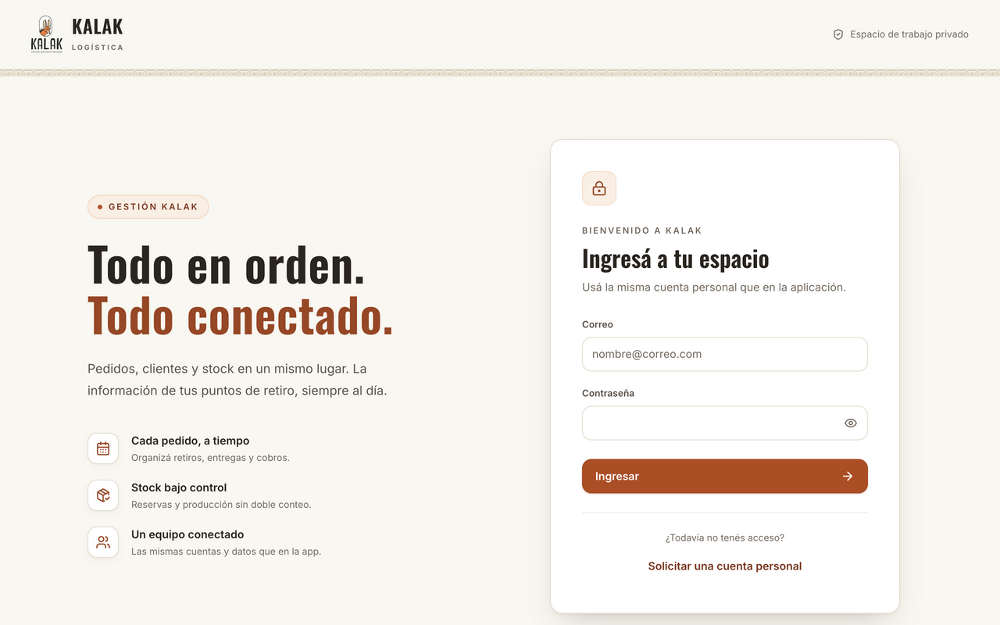

# KALAK logística

Aplicación para gestionar pedidos, stock y retiros desde Android o la web. [Abrir demo](https://kalak-logistica.vercel.app)



## Funcionalidades

- Calendario de pedidos por día, semana o mes, con filtros por punto, cliente, producto, entrega y pago.
- Alta y edición de pedidos con varios productos, precios históricos, observaciones y reprogramación.
- Control separado de entrega y cobro, con efectivo, transferencia o gratis.
- Ventas espontáneas y gestión de stock por ubicación, reservas y producción prevista.
- Catálogo configurable y perfiles con permisos según rol y punto de retiro.
- Informes y exportación Excel, CSV y respaldo JSON.
- Auditoría de cambios y sincronización con Supabase.

## Stack

Expo, React Native, TypeScript, React, Vite, Tailwind CSS y Supabase (Auth y Postgres).

## Cómo correrlo en local

### Web

```sh
npm ci --prefix web
cp web/.env.example web/.env.local
# Configurar VITE_SUPABASE_URL y VITE_SUPABASE_PUBLISHABLE_KEY
npm run web:dev
```

### Android / Expo

APK firmada: [descargar la última versión](https://github.com/MorguiMateo/pedidos-stock/releases/latest).

Requiere Node.js y npm. Configurá `EXPO_PUBLIC_SUPABASE_URL` y `EXPO_PUBLIC_SUPABASE_PUBLISHABLE_KEY` en `.env`.

```sh
npm ci
npm start
```

## Estructura

- `app/`, `src/`: navegación y lógica de la aplicación Expo/Android.
- `web/`: aplicación web Vite.
- `supabase/`: configuración, migraciones y pruebas del backend.
- `docs/`: documentación técnica y operativa.

## Documentación

- [Android](docs/ANDROID.md) · [Despliegue](docs/DEPLOYMENT.md) · [Despliegue web](docs/WEB-DEPLOYMENT.md)
- [Backend](docs/BACKEND.md) · [Contrato KALAK](docs/KALAK.md) · [Seguridad](docs/SECURITY.md)
- [Respaldo y recuperación](docs/RECOVERY.md) · [Verificación](docs/VERIFICATION.md) · [Paridad web](docs/WEB-PARITY.md)
- [Actualizar una instalación](docs/ACTUALIZAR.md)
